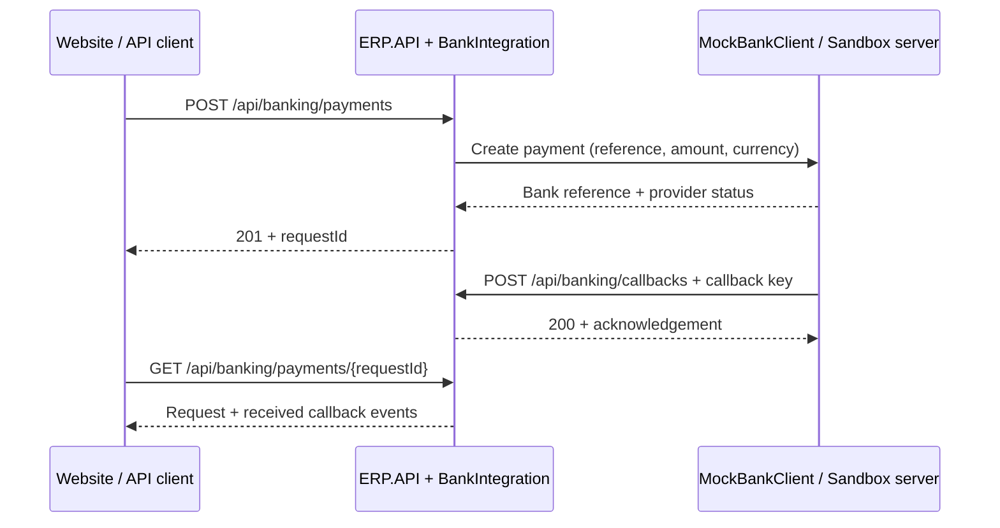

# Bank integration (development)

โมดูลรับ–ส่งข้อมูลแยกจาก ERP.Application, ERP.Domain และ ERP.Infrastructure ไม่มี dependency ไปยังตาราง ERP
API หลักอ้างอิงโปรเจกต์นี้และเรียก `AddBankIntegration()` เท่านั้น ตัว controllers และบริการทั้งหมดอยู่ในโมดูลนี้
ค่าเริ่มต้นใช้ Mock ตามขอบเขตงาน ยังไม่ได้เลือกธนาคารหรือ Payment Gateway จริง

```text
ERP.BankIntegration/
├── Contracts/       request / response / callback ของระบบทดลอง
├── Clients/         IBankClient, MockBankClient, SandboxHttpBankClient
├── Configuration/   options ของตัวเชื่อม
├── Endpoints/       API ที่เว็บไซต์เรียก และ endpoint รับ callback
├── Services/        ประสานการส่งคำขอและรับผล
└── Storage/         เก็บ request และ callback ใน memory
```

## เส้นทางข้อมูล



ใน Mock mode ไม่มี HTTP ออกไปธนาคาร: MockBankClient ตอบเลข `MOCK-...` และสถานะ Pending ใน process
การส่ง callback ให้จำลองด้วยสคริปต์ด้านล่าง ไม่มี callback หรือรายการจ่ายเงินจริงที่เกิดขึ้นเอง
SandboxHttp ส่ง HTTP จริงไปยัง test server ที่ตั้งค่า ซึ่งต้องรองรับสัญญา JSON ของเรา ไม่ใช่ API ของธนาคารใด
หน้าบ้าน Angular ปัจจุบันยังใช้ DemoStore ไม่ได้เรียกโมดูลนี้; endpoint ถูกเตรียมไว้ให้เชื่อมในขั้นถัดไป

## ทดสอบครบ flow ด้วย Mock

รันจาก repository root ใน PowerShell:

```powershell
# สร้าง key ทดลองเฉพาะ terminal นี้ ไม่เขียนลง Git และไม่ส่งให้ browser
$env:BankIntegration__CallbackKey = [guid]::NewGuid().ToString('N') + [guid]::NewGuid().ToString('N')
dotnet run --project backend/ERP.Backend/ERP.API
```

launch profile ของ API ใช้ Development และ port 5080; endpoint นี้คืน 404 นอก Development หรือเมื่อ Enabled=false
เมื่อใช้ API client จำลองธนาคาร ต้องตั้ง callback key ให้ตรงกับ API
สำหรับการทดสอบสอง terminal แบบทำตามได้ทีละขั้น ดู [คู่มือ API](../../../docs/api/banking.md)

## การตรวจที่มีแล้ว

- orderReference ไม่ว่างและไม่เกิน 100 ตัวอักษร; amount 0.01–999,999,999.99 และไม่เกิน 2 ตำแหน่ง; currency THB
- callback ต้องมี EventId, RequestId, BankReference และสถานะ Pending/Paid/Failed/Cancelled
- callback ต้องส่ง `X-Bank-Callback-Key` ตรงกับ key ที่ตั้งไว้บน server (อย่างน้อย 32 ตัวอักษร)
- reference / amount / currency ต้องตรงกับ request ที่โมดูลรับไว้
- callback EventId เดิมและเนื้อหาเดิมตอบรับซ้ำได้โดยไม่เพิ่มข้อมูล; หากเนื้อหาต่างกันคืน 409
- ส่งคำขอออกมี timeout และไม่ retry อัตโนมัติ เพื่อไม่ส่งคำขอซ้ำเมื่อผลจากอีกฝั่งไม่แน่นอน

## ขอบเขตการเก็บข้อมูลและกฎธุรกิจ

ข้อมูลอยู่ใน memory ของ process เดียว หายเมื่อ restart และยังไม่ใช้ SQL Server
คำตอบ received=true หมายถึงรับ callback เข้า memory แล้วเท่านั้น ไม่ใช่ยืนยันการชำระเงินจริง
เก็บ callback เป็นเหตุการณ์ทั้งหมด ไม่ตีความว่าเหตุการณ์ล่าสุดคือสถานะสุดท้าย เพราะข้อมูลอาจมาสลับลำดับ
ไม่แก้ Payments/SalesOrders, ไม่ตรวจออเดอร์จริง, ไม่ออกใบเสร็จ และไม่ตัดสต็อก
POST สร้าง request ใหม่ทุกครั้ง: ยังไม่มี durable inbox/outbox, request idempotency หรือ reconciliation
ถ้าธนาคาร timeout ผล remote อาจสำเร็จแล้ว; โมดูลยังไม่มี API ตรวจสถานะที่ธนาคาร ห้าม retry แบบไม่ตรวจสอบ
callback ที่มาถึงก่อนการสร้าง request เสร็จจะไม่พบ reference (404); การรองรับ race นี้อยู่ในขั้น durable inbox

## เปลี่ยนตัวเชื่อมในอนาคต

เพิ่ม implementation ของ IBankClient ตามเอกสารผู้ให้บริการ แล้วแปลงข้อมูลเป็นสัญญากลาง
เพิ่ม endpoint adapter สำหรับ payload, signature และ acknowledgement ของธนาคารจริง
shared key และ JSON ของตัวจำลองไม่ใช่รูปแบบมาตรฐานที่ธนาคารจริงยอมรับ
การเชื่อมระบบจริงต้องเพิ่มการเก็บข้อมูลถาวร, authentication ของเจ้าหน้าที่ และกฎชำระเงินก่อนเปลี่ยนสถานะ ERP

```powershell
dotnet test backend/ERP.Backend/ERP.BankIntegration.Tests
```
