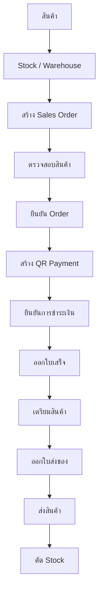

# Flow หลัก

ลำดับนี้ยึดตามที่ผู้ใช้กำหนด เป็นข้อกำหนดสำหรับพัฒนา handlers ต่อจากโครงปัจจุบัน

## สถานะและผลต่อข้อมูล

| ขั้นตอน | สถานะ SalesOrder เป้าหมาย | ผลที่ต้องทำเมื่อ implement |
| --- | --- | --- |
| สร้าง Sales Order | Draft | บันทึกลูกค้า คลัง และรายการสินค้า |
| ตรวจสอบสินค้า | StockChecked | ตรวจสินค้า active จำนวนพร้อมขาย และราคา |
| ยืนยัน Order | Confirmed | ตรวจสต็อกอีกครั้งใน transaction แล้วจองสินค้า |
| สร้าง QR Payment | AwaitingPayment | สร้าง Payment ที่ Pending พร้อมยอดและ reference |
| ยืนยันการชำระเงิน | Paid | Finance ตรวจเงินเข้าจริงและเปลี่ยน Payment เป็น Verified |
| ออกใบเสร็จ | Receipted | สร้าง Receipt พร้อม snapshot เอกสาร |
| เตรียมสินค้า | Preparing | สร้าง Delivery ที่ Preparing และบันทึกการเตรียม |
| ออกใบส่งของ | ReadyToShip | บันทึก snapshot และ DocumentIssuedAtUtc; Delivery เป็น ReadyToShip |
| ส่งสินค้า | Shipped | บันทึก ShippedAtUtc และผู้ส่ง; Delivery เป็น Shipped |
| ตัด Stock | Completed | ลด OnHand/Reserved, เพิ่ม StockTransaction และบันทึก StockDeductedAtUtc |

Enums กำหนดสถานะข้างต้นแล้ว แต่ยังไม่มี state transition handlers
การตรวจสินค้าครั้งแรกไม่ใช่การจอง ยืนยัน order ต้องตรวจอีกครั้งเพื่อรองรับเจ้าหน้าที่ทำงานพร้อมกัน
Available = OnHandQuantity - ReservedQuantity; การจองเพิ่ม Reserved แต่ยังไม่ลด OnHand
เก็บจำนวนจองต่อ order item ใน SalesOrderItem.ReservedQuantity เพื่อรู้ว่าต้องคืน/ตัดของรายการใด

## การส่งและตัดสต็อก

หน้าจอต้องแสดงการส่งก่อนตัดสต็อกตาม flow
ตอน implement ให้บันทึกผลยืนยันส่งและตัด Stock ใน transaction เดียวกันตามลำดับ เพื่อไม่ทิ้งออเดอร์เป็น Shipped แต่สต็อกยังไม่เปลี่ยนจากการบันทึกผิดพลาด
Shipped จึงอาจเป็นขั้นกลางใน transaction ก่อน Completed หากไม่มีระบบขนส่งภายนอก
การส่งจริงเป็นเหตุการณ์ภายนอกฐานข้อมูล: ถ้าส่งของแล้วแต่บันทึกไม่สำเร็จ เจ้าหน้าที่ต้อง retry โดย idempotency key เดิม และต้องไม่ตัดซ้ำ

## กฎที่ต้องบังคับก่อนเปิดใช้จริง

- ทั้งออเดอร์ต้องจองสำเร็จหรือ rollback ทั้งหมดเมื่อสินค้าไม่พอ
- การจ่ายต้องตรงกับ order ยอด THB และบัญชีผู้รับ; ป้องกัน bank reference เดิมใช้ซ้ำ
- ออกใบเสร็จได้หลัง verified payment และหนึ่งใบต่อ order ในรุ่นส่งครบ/ชำระเต็ม
- เมื่อออกเอกสารแล้ว พิมพ์ซ้ำจาก snapshot เดิม ไม่เปลี่ยนตาม master data
- ยืนยันส่งซ้ำต้องไม่เกิด StockTransaction ซ้ำ; OperationKey มี unique index
- การเปลี่ยนยอดกับประวัติ การเปลี่ยน order/payment/receipt และการส่งกับตัดสต็อกต้องอยู่ใน transaction ของแต่ละงาน
- กำหนดเลขเอกสารด้วย database sequence หรือ counter ที่ lock แบบ atomic ไม่ใช้ MAX + 1
- ต้องมี audit log ของการเปลี่ยนสถานะและการปรับยอดก่อนใช้งานจริง
- การยกเลิกก่อนชำระต้องปลดจอง หลังชำระต้องมี flow คืนเงินที่ออกแบบแยกต่างหาก

รายละเอียดตารางอยู่ใน [schema](../database/schema.md)
