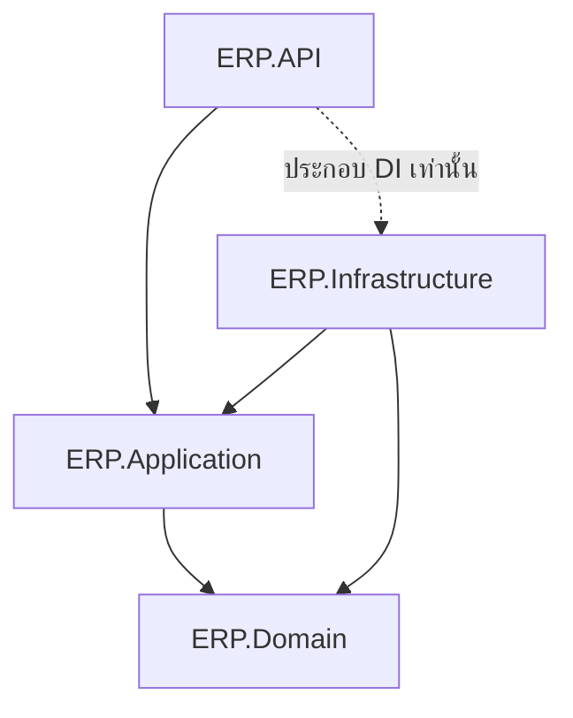

# สถาปัตยกรรม

## โครงสร้างหลัก

- backend/ERP.Backend: solution ของ C# / .NET 10
- frontend/erp-web: Angular 21 สำหรับเจ้าหน้าที่
- database: SQL scripts, SQL migration exports, seed และ ERD
- docs: api, database, flow และ requirements
- ยังไม่สร้าง docker-compose.yml หรือโครง deploy

## Dependency

API อ้างอิง Infrastructure เพื่อ register DbContext และ repository implementations ในจุดเริ่มระบบ
Controllers เรียก Application ผ่าน interfaces; Application และ Domain ไม่รู้จัก EF Core หรือ HTTP
การเพิ่ม reference จาก API ไป Infrastructure เป็นจุดประกอบ dependencies ไม่ใช่การให้ Controllers query DB โดยตรง

| Project | หน้าที่ |
| --- | --- |
| ERP.API | Controllers, middleware, filters, DI extensions และ configuration |
| ERP.Application | DTOs, interfaces, services, validators และ mappings |
| ERP.Domain | Entities รวมในโฟลเดอร์เดียว, enums, constants และ common base types |
| ERP.Infrastructure | DbContext/UnitOfWork, repositories, SQL mappings, migrations และ external services |

ใช้ repository ที่อ่าน/เพิ่มข้อมูลร่วมกันเป็นฐาน แล้วเพิ่ม method เฉพาะงานใน ProductRepository, SalesOrderRepository และ StockRepository
ไม่เปิด IQueryable ออกนอก Infrastructure และไม่ให้แต่ละ repo commit เอง
UnitOfWork ใช้ transaction และ DbContext เดียวกันต่อหนึ่งงาน
กฎตรวจสอบและเปลี่ยนสถานะต้องพัฒนาใน Application/Domain ก่อนเปิด API ของธุรกรรม

Frontend ใช้ core, shared, features และ layouts ตามโครงที่กำหนด
Angular ติดต่อ API เท่านั้น; DBeaver ติดต่อ SQL Server สำหรับงานพัฒนา ไม่ใช่ที่เก็บข้อมูลหรือ backend ของแอป

ดู [โครง backend](../../backend/README.md), [โครง frontend](../../frontend/erp-web/README.md) และ [flow](../flow/main-flow.md)
